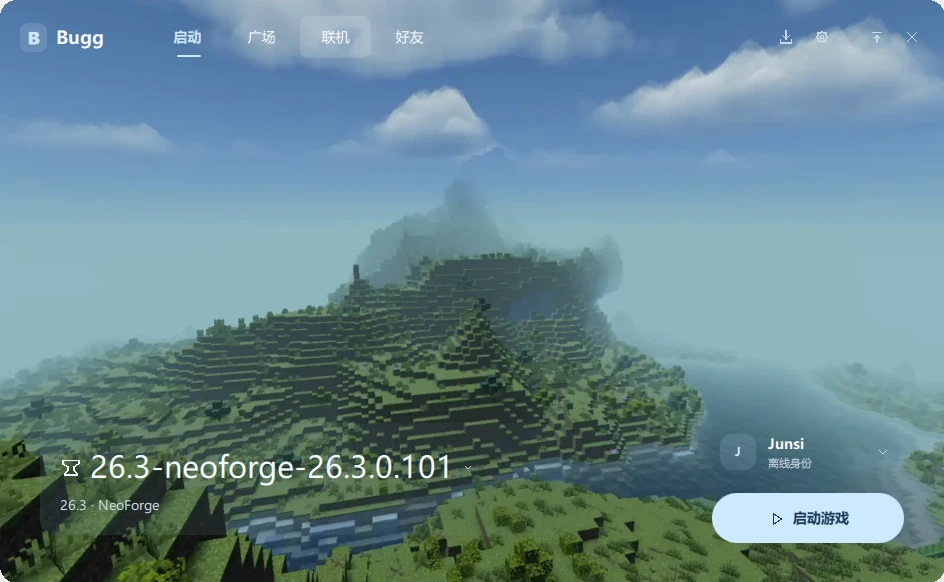

# Bugg 启动器

**挑一个整合包，约几个朋友，进入你们的 Minecraft 世界。**

游戏安装 · 资源广场 · 实例管理 · 好友联机

[**下载 Bugg**](https://download.bugg.icu/) · [**官网**](https://bugg.icu/) · [**玩家教程**](https://bugg.icu/docs) · [**报告问题**](https://github.com/vdjango/buggcraft/issues)

---

Bugg 是一款使用 **C++、Qt 与 QML** 构建的 Minecraft Java 版启动器。安装游戏、挑选模组和整合包、管理不同玩法，再通过房间邀请和朋友一起玩，日常操作集中在一个桌面应用里。

## 从想玩，到开玩

| 你想做的事 | 在 Bugg 里 |
| --- | --- |
| 玩不同版本、不同整合包 | 分别管理游戏实例，选择版本、加载器与运行环境。 |
| 找模组、资源包或光影 | 到「广场」搜索资源，查看介绍、译文和可选文件。 |
| 装一个整合包 | 从广场安装，或导入已有整合包；在任务中查看下载和安装状态。 |
| 和朋友进入同一个世界 | 登录联机账号，创建房间、邀请好友或加入朋友。 |
| 让启动器少占屏幕 | 使用紧凑窗口或悬浮面板，按自己的习惯调整外观与吸附。 |
| 弄清哪里出了问题 | 查看日志与调试信息，筛选、搜索，或导出诊断日志。 |

支持 Fabric、Forge、NeoForge 等加载器。具体游戏与资源的可用版本，以当前目录、文件声明和安装结果为准。

## 三步开始

1. 在 [下载页](https://download.bugg.icu/) 获取适合你系统的版本，打开启动器。
2. 安装 Minecraft、导入整合包，或选择已有实例；按提示准备账号与 Java 环境。
3. 启动游戏。想一起玩时，打开「联机」，登录后创建房间或加入朋友。

首次使用可以查看 [安装游戏](https://bugg.icu/docs/help/download-game)、[导入整合包](https://bugg.icu/docs/help/import-modpack) 和 [联机教程](https://bugg.icu/docs/help/create-room)。

## 联机，留在同一个启动器里

房主运行自己的世界、保管存档，朋友通过邀请加入。网络允许时尝试 P2P，无法直连时使用联机节点中继。

统一服务负责账号登录、设备授权、好友与节点分配；游戏数据通过直连或节点传输。通常无需填写服务器地址，也保留自定义统一服务选项，方便社区自建接入。

- 联机账号、Minecraft 游戏账号分别管理。
- 模组环境与资源同步有独立进度，下载和安装失败时可定位到具体文件。
- 桥和 SDK 复用原生联机实现，更多说明见 [联机节点项目](https://github.com/vdjango/minecraft-tunnel-native)。

## 性能，体现在少等一会儿

- **减少重复读取**：复用实例扫描索引，多个摘要尽量共用一次文件读取。
- **繁重任务放到后台**：下载、解析、校验与文件操作使用后台任务，界面继续显示状态。
- **复用成功文件**：下载与安装按文件校验，失败时重试未完成内容，减少重复下载。
- **适配不同 CPU**：复用 Qt、原生桥与依赖库的硬件优化，保留通用路径。

C++ 和指令集优化是实现方式，不能直接换算成游戏 FPS。实测口径与边界见 [实例扫描报告](文档/28-2026-11-10实例扫描性能优化.md)、[多路径性能报告](文档/29-2026-11-10多路径性能优化.md)；面向玩家的说明见 [体验优化](https://bugg.icu/docs/help/experience)。

## 下载与系统

当前开发与主要验收环境为 Windows。macOS、Linux 的发布情况，以 [下载页](https://download.bugg.icu/) 实际提供的系统和架构为准。

本仓库主分支已切换到新版 C++/Qt 架构。旧版发布记录保留，旧架构源码保存在 `legacy-python-20261112` 分支；发行徽章可能仍对应旧架构版本，请按下载说明选择。

## 反馈与参与

遇到问题，可以使用启动器内的「问题反馈」，也可以提交 [Issue](https://github.com/vdjango/buggcraft/issues)。请附上游戏与加载器版本、资源名称和文件版本、复现步骤及错误日志；发送前移除个人信息与凭据。

欢迎改善教程、译文、界面和代码。开发前先阅读 [协作约束](AGENTS.md)；构建方式见 [构建与发布](文档/10-构建体积与发布.md)，工程与依赖边界见 [架构文档](文档/03-工程结构与依赖边界.md)。

源码包含共享依赖内核的带许可快照；原生联机桥由独立节点仓库提供。单文件构建需要按构建文档准备对应的 Qt 与原生桥源码，不包含第三方预编译运行库。

Bugg 不包含 Minecraft 游戏本体，与 Mojang、Microsoft 无隶属关系。Minecraft 是 Mojang Studios 的商标。
