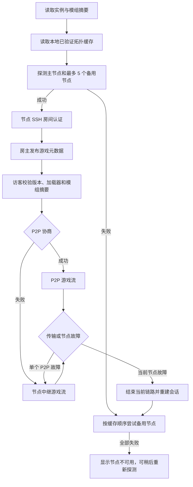

# 启动器联机与节点故障流程

启动器先读取房主实例的 Minecraft 版本、协议号、加载器及加载器版本，并扫描 `mods` 文件生成 SHA-256 摘要。房主建房时，原生桥把这些元数据提交给房间；访客在开始游戏前取得摘要，缺少文件时按摘要下载并再次校验。

拓扑只来自已验证的节点签名记录、节点加入码或上一次成功探测，最多保存 32 条并在一次请求中最多传给原生桥 5 条。缓存写入采用原子替换；刷新失败不会清空上一份可用拓扑。节点加入码或签名身份改变时会重新验证，旧入口连不上时会继续尝试其他候选。

已经建立的 Minecraft TCP 流不能被透明迁移到另一台节点。节点或控制通道掉线后，原生桥将关闭旧链路、显示重连状态、按指数退避重试并依次切换缓存候选；房主重新建立房间，访客重新解析邀请。所有候选不可用时会进入错误状态，不会把半连接显示为在线。P2P 只影响当前玩家的数据通道，控制通道和其他玩家的中继流仍可独立运行。

节点联邦传播签名的公开房间摘要、容量和版本/加载器/模组摘要；私密房间不会通过公开房间列表泄露。联邦记录过期后，启动器重新探测并选择在线入口。节点故障期间不能获取新拓扑时，启动器只能使用上一次缓存；缓存也失效时必须让用户重试或重新领取加入码。
