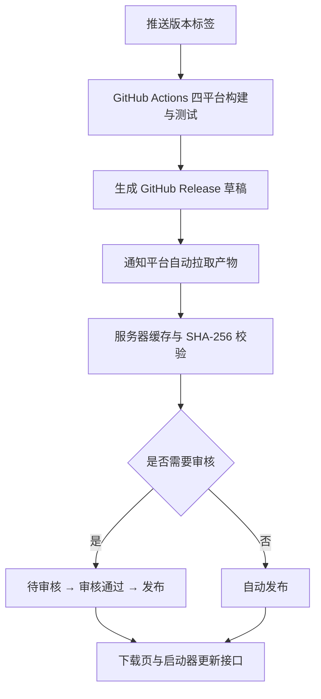

# 启动器版本发布与自动同步

GitHub Actions 构建完成后，平台直接从 GitHub 拉取产物，缓存到服务器并验证完整性。发布者无需下载、解压或手动上传。后台只需设置是否需要审核。

## 入口与账户

- 版本后台：https://download.bugg.icu/admin/
- 公开下载页：https://download.bugg.icu/
- 使用下载平台独立管理员账户；密码不写入代码仓库，保存在本机私有运维资料中。

服务为独立项目 `buggcraft-release-platform`，后台和公开 API 均属于下载域名。服务器首次生成的凭据位于 `/var/lib/buggcraft-releases/admin-credentials.txt`。联机节点不承担启动器发布管理。

## 1. 配置审核方式

打开版本后台，在「GitHub 产物审核」中选择并保存：

| 设置 | 新产物校验完成后的状态 | 后续操作 |
| --- | --- | --- |
| 需要审核（默认） | 待审核 | 检查版本、说明与文件，审核通过后发布 |
| 无需审核 | 已发布 | 自动出现在下载页与更新接口 |

设置只影响此后新入库的版本。切换为无需审核，不会将已有待审核版本自动发布。无论是否审核，文件完整性校验都必须通过。



## 2. 发起新版本构建

完成代码审查和测试后，为已推送的提交创建语义化版本标签：

```bash
git switch main
git pull --ff-only
git tag -a v1.2.3 -m "Buggcraft 1.2.3"
git push origin v1.2.3
```

正式版使用 `v1.2.3`，测试版使用 `v1.3.0-rc.1` 等预发布版本。平台根据 GitHub Release 的预发布标记选择正式或测试通道，并校验其与版本号一致。不要复用版本号；修复安装包应提高版本号。

在 GitHub Actions 中查看 **Package launcher**。四个平台全部构建、测试成功后，`release` 任务创建 GitHub Release 草稿，并调用平台同步接口。GitHub 草稿无需公开，官网发布由平台后台控制。

## 3. 平台自动缓存

正常流程全自动：

1. 工作流获取 GitHub Actions 短期身份凭证，通知平台同步对应标签。
2. 平台验证仓库、标签、工作流、签名与有效期，使用该任务临时 GitHub Token 读取草稿产物。
3. 平台并行下载、计算 SHA-256、比对校验文件与版本标记。
4. 文件完整且校验通过后，原子入库，按照当前审核设置进入待审核或直接发布。
5. 工作流等待平台确认完成，再结束任务。临时 Token 不写入磁盘，不需要配置长期 GitHub PAT。

平台还会每 5 分钟检查一次公开 GitHub Release，后台可点「立即检查 GitHub」。公开轮询无法读取私有草稿；若草稿同步失败，在 GitHub Actions 重跑对应 `release` 任务即可。后台展示检查时间、同步状态、失败原因与版本处理结果。

同一版本重复同步会跳过已有记录。已撤回版本不会被自动重新发布。缺少完整文件的历史版本会显示「构建文件尚未齐全」，不会生成不完整版本。

### 产物约定

| 平台 | 安装包 | 校验文件 |
| --- | --- | --- |
| Windows x64 | `Buggcraft.exe` | `SHA256SUMS-windows-x64.txt` |
| Linux x86_64 | `Buggcraft` | `SHA256SUMS-linux-x86_64.txt` |
| Linux ARM64 | `Buggcraft-linux-arm64` | `SHA256SUMS-linux-arm64.txt` |
| macOS Apple Silicon | `Buggcraft-macos-arm64.zip` | `SHA256SUMS-macos-arm64.txt` |
| macOS Intel | `Buggcraft-macos-x86_64.zip` | `SHA256SUMS-macos-x86_64.txt` |
| 版本标记 | `BUGGCRAFT_VERSION.txt` | 内容必须等于不带 `v` 的标签版本 |

版本标记由工作流根据标签生成，用于校验本次产物的发布版本，不代替可执行文件本身的版本检查。校验文件采用 `SHA256  文件名` 格式。

单文件上限 1.5 GB，整组文件上限 3.5 GB；同步前预留至少「本次文件大小 + 5 GiB」磁盘空间。最多同时下载两个文件，以流式方式写盘和计算哈希，不把整包读入内存。未发布文件存放于私有目录，公开下载接口不提供访问。

### 备用手动导入

页面底部折叠项「备用：手动导入构建文件」仅用于同步故障时应急。它支持 8 MiB 分片上传、进度显示与失败重试；日常发布不需要使用。

## 4. 审核、发布与撤回

需要审核时，新同步版本直接进入「待审核」。管理员检查版本号、通道、发行说明和文件清单，点击「审核通过」，再点击「发布版本」。可以退回草稿，或撤回已发布版本。

草稿、待审核、审核通过状态均不出现在公开下载与更新接口中。发布后立即可用，无需等待历史缓存定时任务。正式版版本号必须高于当前已发布正式版。

撤回后，公开列表、更新检查和文件下载均停止提供该版本；服务器保留文件和审计记录。已安装的客户端不会自动降级。恢复撤回版本需要管理员操作，GitHub 自动同步不会代为恢复。

## 5. 接口

### 管理接口

管理接口使用下载平台管理员登录会话；写操作同时校验 CSRF。

| 方法 | 路径 | 用途 |
| --- | --- | --- |
| GET | `/api/admin/launcher/releases` | 版本记录、审核设置、同步状态、CSRF |
| POST | `/api/admin/launcher/settings` | 设置 `publish_mode`：`manual` 或 `automatic` |
| POST | `/api/admin/launcher/sync` | 立即检查公开 GitHub Release |
| POST | `/api/admin/launcher/releases/{version}/transition` | 提交、审核、发布、撤回等状态操作 |
| POST | `/api/launcher/github-sync` | Actions 专用同步与状态查询，要求指定工作流的 OIDC 身份 |

Actions 同步请求携带 `tag`、`action: sync` 和临时 `github_token`；状态请求携带 `tag`、`action: status`。OIDC 的 audience 必须等于 `https://download.bugg.icu/api/launcher/github-sync`，只接受 `vdjango/buggcraft` 仓库 `.github/workflows/package.yml` 的标签运行。

### 公开接口

| 方法 | 路径 | 用途 |
| --- | --- | --- |
| GET | `/api/launcher/releases` | 已发布版本与撤回版本号 |
| GET | `/api/launcher/update` | 查询指定平台、通道的可用更新 |
| GET | `/api/launcher/assets/{version}/{name}` | 下载已发布的服务器缓存文件 |

更新检查示例：

```text
https://download.bugg.icu/api/launcher/update?current=1.2.2&platform=windows-x64&channel=stable
```

`platform` 支持 `windows-x64`、`linux-x86_64`、`macos-x86_64`、`macos-arm64`；`channel` 支持 `stable`、`beta`。测试通道同时接收更新的正式版。响应有更新时包含文件大小、SHA-256、服务器下载地址和发行说明。客户端必须再次校验文件大小与哈希。

下载地址始终是平台自己的 `/api/launcher/assets/{version}/{name}`。七牛私有对象同步并校验完成后，下载站以 HTTP 302 跳转到 10 分钟有效的七牛签名 URL；对象未就绪或同步失败时，直接由已发布的本地缓存响应。公开版本列表和更新响应不会暴露七牛对象键或签名链接。撤回版本后平台立即拒绝新下载请求；已签发的七牛链接最多保留到其 10 分钟有效期结束。

兼容旧版启动器时，文件接口对 `User-Agent: Buggcraft-Launcher` 直接返回同域名下的已校验本地缓存，支持 HEAD 与 Range，不发送跨域跳转。beta.12 只信任下载站自身域名，因此必须由服务端保留这条路径，不能要求先安装新启动器才能更新。支持下载票据的新版点击下载时访问 `asset.ticket_url`，由 HTTPS JSON 响应提供七牛签名 URL；网页下载继续走七牛 302。所有路径均先检查版本仍为已发布状态，客户端仍核对大小和 SHA-256。

更新检查和更新提示只保存平台稳定地址，不保存短时签名链接；用户点击更新时才请求稳定地址，由平台为这次实际下载生成新的七牛签名链接。启动器仅接受 HTTPS 下载站与 `kodo.bugg.icu` 之间的跳转，下载结束后仍校验文件大小和 SHA-256。因此提示放置一天或更久不会让下载链接过期。

## 6. 运维与历史兼容

服务单元为 `buggcraft-releases`，仅监听本机 `127.0.0.1:18449`，经下载域名的 Nginx 转发。持久化目录为 `/var/lib/buggcraft-releases`；版本、设置和审核记录位于其中的 `launcher-releases/releases.json`，同步状态位于 `launcher-releases/github-sync.json`，文件位于 `launcher-releases/assets/`。这些数据应独立备份，部署时不能覆盖。服务重启会将未完成同步标记为中断；公开版本下轮重试，草稿可重跑 Actions。

七牛 AK/SK 从 `/etc/buggcraft-releases.env` 读取，文件权限应为 `0600`；对象同步索引位于 `launcher-releases/qiniu-sync.json`，不含密钥。服务只镜像已发布文件，最多并发两个上传，失败后自动重试。私有下载签名只在每次获准下载时生成，不写入日志或版本清单。

下载页保留部署前的历史版本快照 `release-history.json`，并与平台已发布列表合并；平台记录优先，撤回版本会隐藏。旧的 GitHub 历史缓存任务继续维护已有文件，但不会绕过新平台审核，将后续 GitHub 版本直接显示在下载页。

尚未包含自动更新代码的旧启动器，需要用户先从官网下载并安装一次新版。服务器发布新接口不能替旧客户端补上更新代码。

## 7. 启动器内的更新行为

打包版启动后约 10 秒检查一次更新，之后每 4 小时检查；源码开发运行不弹出更新提示。版本号由构建标签写入包内的 `resources/app-version.txt`。

「设置 → 启动器更新」选择「稳定版」时查询 `stable` 通道，选择「开发版」时查询 `beta` 通道。测试版不会推送给稳定版通道。发现新版本后，用户点击「立即更新」，启动器从下载站下载对应平台文件，核对大小和 SHA-256，再替换程序并重启；游戏仍在运行时先提示用户关闭游戏。选择「稍后提醒」或关闭提示后，同一版本 24 小时内不再自动弹窗，重启后仍有效；更新版本可立即提示。手动检查与切换通道不受提醒间隔限制。

设置页显示当前版本和检查结果，提供「检查更新」和「官网版本页」按钮。切换通道立即重新检查，无需重启；无新版本、网络失败、下载校验失败均显示状态。手动再次检查可重新提示之前选择稍后更新的版本。Windows 单文件更新会等待界面进程和外层启动进程退出，替换失败保留原程序，并在程序旁记录 `.update-error.log`。

自动同步遇到草稿按标签查询返回 404 时，下载站会使用同一临时凭证从 GitHub 版本列表查找对应草稿，支持分页。未找到的标签和权限错误仍报告失败，不会导入其他版本。
