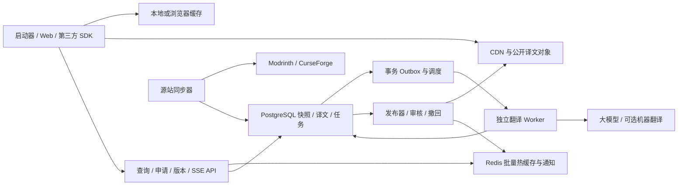

> 实现进度（2026-10-25）：平台已在独立项目 `minecraft-translation-platform/` 实现并部署。入口：[译文库](https://translate.bugg.icu/) · [开放文档](https://translate.bugg.icu/docs) · [开发者申请](https://translate.bugg.icu/developers)。已提供分页、项目资料、原文/译文 HTML 与 Markdown 安全渲染、更新翻译状态、后台队列、开放接口和五种语言示例。启动器源码已接入设置开关及默认 Buggcraft 源。实现和边界以独立项目 README、测试报告及配套 OpenAPI 为准；当前后台已拆分为概览、模型与额度、任务、用量费用、邮件、接入申请、译文反馈七个页面。

# Minecraft 资源翻译平台完整规划

状态：规划存档，基础平台已实现和部署。调研与实现日期：2026-10-25。适用对象：Buggcraft、其他 Minecraft 启动器及独立 Web 用户。

建议建设独立的公共译文平台：**稳定项目 ID 定位，按原文哈希查询已有译文，缺失时异步生成，更新时只翻译发生变化的部分**。采用用户提供的 OpenAI 兼容付费模型服务作为首选生成通道；传统翻译 API 和免费模型为可选插件。平台没有配置任何生成引擎时，仍可提供已有译文、人工贡献、版本查询和开放接口。

本文配套 [已实现的 OpenAPI 契约](resource-translation-openapi.json) 和 [跨语言哈希样例](resource-translation-hash-vectors.json)。文中性能数字仍属于规划目标或计算假设；已完成的压测与验证单独记录在独立项目 `docs/test-report.md`，不可混为实测结果。

## 1. 产品范围与优先级

### 1.1 第一阶段必须完成

| 领域 | 功能与行为 |
| --- | --- |
| 资源覆盖 | Modrinth、CurseForge 的模组、资源包、光影、整合包；同一种协议处理四类资源 |
| 列表 | 中文简介；原始名称保留，可附中文别名；分类、加载器等固定词汇本地字典翻译 |
| 详情 | 简介、完整介绍；原文/译文切换；显示机器翻译或人工校对及原文版本 |
| 更新 | 原文快照、字段哈希、版本历史、更新发现、按需重译、旧译文标识 |
| 慢任务 | 先显示内容，后台排队；段落完成后逐步展示；失败与额度耗尽不阻塞阅读和安装 |
| 共享 | 不同用户、Web 和不同启动器复用同一公开译文与生成任务 |
| Web | 搜索/浏览已收录项目、双语详情、版本历史、纠错、开发者文档和运营后台 |
| 开放接入 | 批量查询、异步任务、SSE/轮询、完整 OpenAPI、哈希 SDK 和示例 |
| 运营 | 额度、预算、引擎健康、队列、Token/费用、邮件、接入申请与反馈审核 |

### 1.2 后续阶段

增加版本更新日志、中文别名搜索、术语库贡献、人工逐段校对、作者认领、离线译文包、更多语言、其他上游适配器、增量订阅。图片内文字和本地游戏语言文件属于独立扩展，需要另定文件处理、授权、打包与更新协议。

第一阶段翻译启动器展示的公开介绍，不修改模组 JAR、资源包、整合包清单、文件名、依赖、校验值和游戏内语言文件。AI 生成的介绍不能成为兼容性、依赖和安装决策的数据来源。

### 1.3 推荐默认设置

- 启动器设置提供翻译开关，默认关闭；开启后自动查询和申请可见内容的译文，无需逐项点击。当前提供 Buggcraft 源。
- 有公共生成额度时，当前可见列表的简介和用户打开的详情可以自动申请生成；不预翻译所有搜索结果。
- 专有名称默认保留英文；中文名称使用独立别名字段，避免搜不到原项目。
- 机器翻译、人工校对、过期译文有简短明确的状态，始终能查看原文。
- 完整翻译与 AI 总结分成不同功能；不得用摘要冒充完整译文。

## 2. 现有项目的接入位置

已检查当前工作区实现：

| 位置 | 当前行为 | 建议接入方式 |
| --- | --- | --- |
| `src/buggcraft/core/content.py` | 汇总 Modrinth/CurseForge，已有来源标识和并发查询 | 保留上游原始字段，在查询后增加独立翻译查询层 |
| `src/buggcraft/core/curseforge.py` | 将 CurseForge 字段转为启动器统一结构，详情含 HTML 正文 | 适配器提供原始 `summary`、`description` 和格式，不对展示文本计算哈希 |
| `src/buggcraft/ui/pages/download/content_browser.py` | QThreadPool 执行搜索和详情；简介截断至 180 字符，正文处理后展示 | 哈希必须在截断、去图片、HTML 转文本之前计算；翻译使用独立网络并发池和代次标识 |
| `resources/qml/launcher/ContentCatalogue.qml` | 展示 `display_summary` | 原文首屏返回后，再按项目键局部补充译文 |
| `resources/qml/launcher/ContentDetails.qml` | 展示正文和文件列表，正文使用 MarkdownText | 增加语言切换与段落状态；详情翻译不影响版本文件选择 |
| `packaging/content_gateway.py` | aiohttp 元数据代理 | 上游适配逻辑可参考；翻译另立服务、数据库和额度，不把模型调用放进代理请求 |

当前内容网关文档规定缓存最多 32 项、有效期 5 分钟。这是元数据代理缓存，不能承担持久译文库，也不能拿 5 分钟当原文更新保证。联机节点、原生传输桥接无需承担翻译职责。

## 3. 免费服务与大模型调研

### 3.1 推荐接入顺序

已实现 OpenAI Chat Completions 兼容适配器，服务为用户指定的 `https://drc.totokens.cc/v1`，使用 `gpt-6.1-sol` 与 `reasoning_effort=medium`，并通过真实调用与项目正文生成验证。模型可以付费，按实际质量、延迟、并发和成本选择，不以免费额度作为首要约束；密钥只存服务端环境文件。以下免费选项属于最初规划阶段的备选调研，尚未接入。

| 选择 | 本次官方资料核实结果 | 平台定位 |
| --- | --- | --- |
| 硅基流动免费模型 | 官方说明实名认证后可使用免费模型，调用费用为 0，免费模型有固定限流；具体模型和价格以价格页/账户为准 | 国内原型与公共低优先级生成候选；先用 Minecraft 样本测质量与稳定性 |
| Gemini Developer API | 部分模型提供免费输入/输出；具体限额在 AI Studio 查询，按项目限制；免费层的数据使用规则与付费层不同，且有服务地区条件 | 可选免费引擎，不能把匿名无限调用或固定额度写成保证 |
| OpenRouter 免费模型 | 提供免费模型调用机制，受账户及模型限额限制；官方支持页明确免费模型不适合生产保障 | 试验或低优先级备用；本次文档渲染未完整显示额度表数字，不将网上旧限额作为合同 |
| 百炼新人额度 | 官方规则为特定地域/模型的新人额度，通常有 90 天有效期，额度耗尽或到期后可能转付费 | 试运行预算，不计入永久免费供给 |
| 自托管开放权重模型 | 需逐模型核验许可证、语言能力、显存及部署要求；API 调用可自行开放 | 可控制吞吐与数据处理，但 GPU、主机、电力和运维有成本 |
| Azure Translator F0 | 官方定价页列出每月 200 万字符免费额度 | 可选传统翻译插件 |
| Google Cloud Translation | NMT 每月前 50 万字符通过每月抵扣额免费；其他模型与资源另算 | 可选传统翻译插件，不与 Gemini 免费层混为一谈 |
| DeepL | 官方帮助中心当前说明：新 Developer 免费试用共 100 万字符、用完不重置；旧 API Free 每月 50 万字符但已不能新购 | 不能再向新用户承诺“注册即每月 50 万字符永久免费” |
| LibreTranslate | 开源、自托管、可离线，项目使用 AGPL-3.0 | 可选本地机器翻译；开源不代表官方托管 API 免费无限量 |

资料：[硅基流动限流](https://docs.siliconflow.cn/docs/userguide/faqs/rate-limit-and-upgradation)、[价格](https://www.siliconflow.cn/pricing)；[Gemini 定价](https://ai.google.dev/gemini-api/docs/pricing)、[限流](https://ai.google.dev/gemini-api/docs/rate-limits)、[地区](https://ai.google.dev/gemini-api/docs/available-regions)；[OpenRouter 限额](https://openrouter.ai/docs/api_reference/limits)、[服务说明](https://openrouter.ai/support)；[百炼新人额度](https://help.aliyun.com/zh/model-studio/new-free-quota/)；[Azure 定价](https://azure.microsoft.com/en-us/pricing/details/translator/)；[Cloud Translation 定价](https://cloud.google.com/products/translate/pricing?hl=en)；[DeepL 计划](https://support.deepl.com/hc/en-us/articles/360021200939-DeepL-API-plans)；[LibreTranslate](https://github.com/LibreTranslate/LibreTranslate)。

建议公共译文免费读取，后台生成由运营方承担可控模型成本，并受公开额度和排队策略约束；暂不增加面向玩家的充值/计费系统。不存在经本次调研验证、可保证长期免费、无限量且高并发的公共生成服务。第三方 API 的译文存储、再分发和服务使用范围，在启用适配器前根据当时合同确认；上表的免费额度不等于这些权利的授予。

### 3.2 引擎适配器

统一内部接口：`translate(segments, source_language, target_language, glossary, context, deadline) -> segment_results + usage`。

配置包含 `provider_id`、`model_id`、受管理的 `base_url`、密钥引用、地区、上下文上限、RPM/TPM/日额度、最大并发、输入/输出单价、超时、是否支持结构化输出和流式响应。平台公共请求不能自选任意 URL、系统提示词或模型，以免变成开放代理。

所有接口兼容性通过适配器能力表和契约测试确认，不能因为某服务支持相似请求格式就假定它也支持术语、JSON Schema、缓存、批处理和取消。

无引擎或生成额度耗尽时：命中的译文正常返回；未命中项为 `deferred`，带 `retry_after_seconds` 和原因。不得接受任务后永久显示“正在翻译”。

### 3.3 用户提供的 OpenAI 兼容服务接入方案

依据 [OpenAI Docs 的 Chat Completions 协议](https://developers.openai.com/api/reference/resources/chat/subresources/completions/methods/create)规划最小交集：服务端通过 Bearer 鉴权调用 `POST /v1/chat/completions`，请求提供 `model` 与 `messages`，读取 `choices` 中的文本和 `usage`。这里的 `/v1` 为待验证候选路径；配置中保存完整 `base_url`，避免客户端库与手工拼接产生重复 `/v1/v1`。官方协议不能证明第三方服务已经支持全部参数。

建议服务端配置示意：

```text
TRANSLATION_PROVIDER=openai-compatible
TRANSLATION_BASE_URL=https://drc.totokens.cc/v1
TRANSLATION_MODEL=<实施时确认的实际模型ID>
TRANSLATION_API_KEY=<从环境或密钥管理注入，不写入配置文件>
TRANSLATION_MAX_CONCURRENCY=4
TRANSLATION_DAILY_BUDGET_CNY=<运营方设置>
TRANSLATION_MONTHLY_BUDGET_CNY=<运营方设置>
```

模型 ID、币种与实际单价不能从主机名推断；运营后台维护价格版本，供应商若按倍率或其他单位结算，先映射统一成本口径。首轮兼容性验证包括：模型列表（若支持）、短文本、JSON 输出、usage、流式中断、超时、429、上下文长度和实际计费。连接超时建议 5 秒，单批总期限初始 60 秒，按真实 P95 调整；并发 4 只是起点，不是已获供应商授权的容量。

优先结构化输出；只有该模型实测支持时才传 `response_format=json_schema`，否则回退到受约束 JSON 输出并做严格本地验证。`max_tokens/max_completion_tokens`、temperature、推理配置、stream usage 等均由能力表选择；不因参数不支持而盲目重复付费请求。翻译任务不使用工具调用；最终正文仍由平台安全组装。

缓存命中不调用该服务；普通用户不能传入自己的任意提示词/模型要求平台代付。初期用同一合格模型完成闭环；只有成本/质量证据支持时再分轻量/高质量模型。密钥只保留在运行环境或密钥管理中，本文、OpenAPI、样例和 Git 均不包含真实密钥。

## 4. 整体架构与技术选择



建议独立仓库 `minecraft-translation-platform`，API 使用 Go，Worker/内容解析使用 Python，Web 使用 Vue 3 + TypeScript，持久化使用 PostgreSQL，Redis 处理热缓存、限流和短期通知，对象存储 + CDN 分发已发布译文。Go 是降低读取服务资源开销的工程选择，不是性能保证；如团队更熟悉 Python，可先用独立 aiohttp/FastAPI 服务完成同一契约，压测确有瓶颈再更换读取服务。

第一版部署 API、同步器、Worker、Web 发布器几个进程即可；不用先拆十几个微服务，不引入 Kafka、向量数据库或 Kubernetes。任务事实和租约保存在 PostgreSQL，通过 Outbox 异步派发；Redis 不是任务的唯一持久副本。API 读取过程不访问模型或源站。

可先在同一台主机部署，但翻译服务与联机/下载网关采用独立进程、连接池、资源限额和密钥。后续读 API、Worker、SSE 和数据库可独立扩容。

## 5. 身份、字段与哈希协议

### 5.1 资源身份

统一资源引用：

```json
{
  "provider": "modrinth",
  "project_id": "AANobbMI",
  "entity_type": "project",
  "entity_id": "AANobbMI"
}
```

`provider` 使用注册表中的稳定小写名称；上游正式 project ID 是主键，不用 slug。`entity_type=version` 时 `entity_id` 使用正式版本/文件 ID，供更新日志使用。项目身份必须带来源，同名项目或相同数字不能跨平台直接合并。跨站关联另建带证据与审核状态的映射。

这与“ID 不变，资料变了仍能查到”的需求一致：数据库先以 `provider + project_id` 找到同一个项目，再查看其创建时间、作者和内容历史。`created_at` 作为身份核验信息；`author_ids/author_names` 是可变化的属性，作者转移、团队变更或更名不能生成一个新项目。查询可携带 `identity_hint`，平台保存并核验，但不把它拼入主键，也不信任客户端提示覆盖源站信息。

如果极少数提供方出现删除后 ID 重用、历史合并或创建时间不一致，保留 tombstone 与平台内部 `resource_id`，暂停自动合并并核验来源；不能静默把旧作者的译文归给另一项目。

`kind` 使用 `mod/resourcepack/shader/modpack`，属于资源属性，不作为全平台通用主键的一部分。后续其他提供方通过注册适配器扩展，而不是接受未经校验的任意来源和 URL。

### 5.2 三种哈希各司其职

| 名称 | 输入 | 用途 |
| --- | --- | --- |
| `metadata_hash` | 适配器定义的稳定元数据投影，包括作者、分类、支持版本等 | 检测项目资料变化、刷新详情；不直接决定是否翻译 |
| `snapshot_hash` | 某实体所有可翻译字段的完整字段哈希映射 | 检测整份介绍变化和版本记录 |
| `source_hash` | 单个原文字段的规范信封 | 精确查询该字段译文，是最常用查询参数 |

下载次数、关注数、浏览量、抓取时间、更新时间戳、签名 URL/过期参数等不进入翻译快照。`metadata_hash` 的投影也排除这些噪声项；如果业务确实需要整个原始 JSON 的哈希，可另存 `raw_payload_hash` 用于审计，不能让它驱动重译。

标题、简介、正文分别计算 `source_hash`。正文变化不会让简介缓存失效；简介变化不要求重翻整篇正文。列表只有简介和标题时，只提交这两个字段哈希，不能为凑完整项目哈希而给每行补抓详情。**未知正文与空正文是不同状态**，不得把未获取正文当成空字符串算完整快照。

### 5.3 `mc-text-v1` 规范

字段信封固定为以下结构，所有值均为字符串：

```json
{
  "schema": "mc-text-v1",
  "field": "summary",
  "source_language": "en",
  "format": "plain",
  "text": "A performance optimization mod."
}
```

1. 源数据按提供方适配器提取：Modrinth `title/description/body` 对应 `title/summary/body`，正文格式 `markdown`；CurseForge `name/summary/description` 对应同名规范字段，正文格式 `html`。版本日志按其真实返回格式适配。原文语言不确定时用 `und`，不能由不同客户端各自猜一个值；第一版适配器统一使用 `und`，显式英语 `en` 留给已确认语言的其他适配器及样例。
2. `text` 仅统一 `CRLF -> LF`、剩余 `CR -> LF`；保留首尾空白、Markdown、HTML、Unicode 和 URL，不做 trim、NFC/NFKC、HTML 解码、去标签、UI 截断或自动翻译。拒绝不合法 Unicode。
3. 采用 [RFC 8785 JCS](https://www.rfc-editor.org/rfc/rfc8785) 规范 JSON 序列化，UTF-8 无 BOM，然后 SHA-256。输出为 `sha256:` 加 64 位小写十六进制。
4. `snapshot_hash` 对 `{"schema":"mc-snapshot-v1","fields":{"title":"sha256:…","summary":"sha256:…","body":"sha256:…"}}` 同样进行 JCS + SHA-256；只在适配器确认字段完整后发布。版本实体用其完整可翻译字段集合，不混入项目正文。
5. 哈希规范变更必须升 schema 版本；客户端通过 capabilities 识别，不在同一版本内改变清洗规则。SDK 提供上述协议的测试向量，Python/TypeScript/Java/C# 实现必须全部得到同样的摘要。

模型处理的是服务端从原文解析的安全文本节点，但查询哈希对应完整原始字段。因此 UI 渲染差异不会造成跨启动器哈希不一致。HTML 属性、链接或排版修改会改变正文哈希；解析后文本相同的段落仍可复用，最终按新结构重新组装。

### 5.4 翻译身份与输出版本

公开查询维度：`资源引用 + 字段 + source_hash + target_language + profile`。

实际生成键增加 `context_hash + policy_revision`；策略版本绑定提示词、术语库版本、分段器和渲染器版本，模型及采样参数写入 provenance。公共 `profile=minecraft-v1` 是稳定产品协议，当前接受哪些生成策略由服务器决定，客户端无需知道模型名称。

上下文主要包含原项目标题、领域和必要的相邻文本。字段没变但相关上下文或术语变了，可能需要重新生成；这类失效由依赖记录判断。**不能仅凭正文文本相同，就在不同项目、不同术语或相反上下文间直接复用译文。**

同一原文可以人工修订或更换译法，故 `source_hash` 不等于输出版本。每次发布产生新的 `translation_revision`、`artifact_id` 和 `artifact_sha256`。只有带输出摘要的对象路径可长期 `immutable`；“某个原文哈希当前最佳译文”的接口仍是可变选择结果，使用短 TTL、ETag 和主动清除。

## 6. 原文更新发现与一致性

### 6.1 两条更新通道

**客户端发现：**启动器本来就会获取源站列表和详情，直接用完整原文算哈希。已有译文命中即可读取；未知新哈希由 `ensure` 申请核验。平台拉取同一来源确认内容后生成。客户端文字或哈希只是提示，不直接成为公共真相；已注册的可信服务端适配器可走单独授权的 ingestion。

**服务端主动发现：**同步器按热度扫描，优先使用源站支持的条件请求、变更信息或官方事件；无法获得可靠事件时，对介绍正文定期重新获取并比较。项目“最近修改时间”只作为调度提示，不能假设它覆盖正文的每次改动。Modrinth 与 CurseForge 详情字段及端点分别以[官方项目接口](https://docs.modrinth.com/api/operations/getproject/)和[官方 API 文档](https://docs.curseforge.com/rest-api/)为依据。

单独保存 `metadata_checked_at` 与 `body_checked_at`。拿到搜索摘要不代表已核验正文；网关/CDN 缓存响应也不代表刚访问了原站。记录来源、Age/上游缓存时间（如有）、校验时间和下一次检查时间。适配器若无可靠缓存年龄，应明确 `freshness=unknown`。

### 6.2 建议新鲜度分层

| 项目状态 | 主动核验建议 | 说明 |
| --- | --- | --- |
| 当前被浏览且有旧快照 | 客户端发现新哈希后立即申请，服务端合并核验，目标 30 秒内开始 | 开始核验不等于完成翻译；受上游配额和网络约束 |
| 热门项目 | 正文约 5 分钟检查一次 | 先按配额测算可覆盖多少项目；随机抖动防整点峰值 |
| 普通项目 | 约 1 小时检查一次 | 有最近访问记录的优先 |
| 长尾无人访问 | 约 24 小时或再次访问时检查 | 不为承诺“实时”耗尽上游额度 |
| 作者主动更新通知 | 收到后立即排队核验 | 需要鉴权与来源确认，不直接发布通知携带内容 |

没有可靠上游事件就不能保证所有项目秒级发现。哈希用于判断是否一致，本身不能主动感知上游。验收分别统计“发现延迟”“排队等待”“生成耗时”“发布传播延迟”，不能合成一个无法解释的实时指标。

容量例子：2,000 个热门项目每 5 分钟核验一次，约需 6.67 次/秒；如果元数据与正文分端点，则约 13.33 次/秒，另加其他访问。必须依据真实上游限额缩小热集合或延长周期，不能硬编码全站高频扫描。

### 6.3 更新处理顺序

1. 获取并保存完整源快照，比较每个字段哈希，事务内推进“当前已核验原文”指针。
2. 新原文指针不等待翻译完成；该字段新版本状态立即成为 `missing/queued`。旧译文保留历史，但不能被当作新哈希的 `ready` 响应。
3. 为变化字段建立增量任务；只修改正文一个段落时，复用相同上下文下已验证的段落结果。
4. Worker 的任务绑定原文哈希和策略版本；写回时用条件更新，防止较旧任务覆盖更新版本。
5. 新译文通过结构检查后发布独立 artifact，再更新选择指针，失效 Redis/CDN 可变键，发送更新事件。
6. 原文 A→B→A 时可复用 A 的适用译文，但仍记录新的源版本历史；项目删除/撤回后执行撤回标记和缓存清理。

客户端带 A 哈希时，平台可返回已核验的 A 历史译文，`matches_request=true`；如果已知当前是 B，另标 `is_current=false`。客户端带 B 时，不能把 A 放到当前 `translation`，只允许在用户选择允许旧版时放到 `fallback_translation`，并返回 `fallback_source_hash=A`。

正在阅读详情更新时，不突然替换整篇并跳动滚动条：原文哈希改变提示“介绍已更新”；用户切换到新版本。当前原文的异步译文按段落更新，保留锚点。

## 7. 慢任务的完整用户流程

### 7.1 列表

1. 源站结果到达后直接展示原名称、原简介，并读本地缓存；翻译不延迟原列表。
2. 对当前可见的 20～50 个项目合并一次 `translations:resolve`，只查询标题/简介，不传整篇正文。滚动与连续搜索做约 100～200ms 合并。
3. `ready` 项局部更新；`missing` 项可按自动翻译设置合并调用 `translations:ensure`；已有任务直接复用。
4. SSE 或批量轮询返回完成事件后重新 resolve。换页/改搜索递增 request generation；过期回调不更新当前页。

### 7.2 详情

原文和文件列表可先用；优先完成简介和首屏段落，然后正文其余段落。显示“等待翻译”“已完成 3/8 段”“生成暂不可用”等真实状态。无法估计时不显示伪造百分比或精确倒计时。

对模型 token 流只做后台接收，前端发布已完成校验的段落，避免将不完整 HTML/Markdown 或截断句子作为正式译文。语言切换不重新调用模型；关闭页面取消订阅，不取消其他用户共享任务。

## 8. 开放接口契约

建议基础路径 `/v1`。示例主机 `https://translate.example.invalid` 是占位地址。OpenAPI 文件定义第一阶段发现/会话/目录/历史/读取/生成/任务/事件/反馈接口，扩展管理端单独分组，不把内部密钥配置接口暴露到公共契约中。

### 8.1 路由总览

| 方法与路径 | 作用 | 关键约束 |
| --- | --- | --- |
| `GET /v1/capabilities` | 哈希规范、provider、语言、profile、上限、生成是否可用 | 可公开缓存；返回当前配置，不硬编码免费额度 |
| `POST /v1/sessions/anonymous` | 为桌面/Web 获取短期匿名生成会话 | 按真实来源 IP 和全局配额限制签发；公开 client_id 不具备鉴权能力 |
| `GET /v1/catalog/projects` | 分页浏览已收录项目 | 游标分页、可按来源/类型筛选，不同步抓取源站 |
| `GET /v1/catalog/search` | 搜索已收录标题、别名和简介 | 参数化查询，返回原站 ID 和来源；中文增强检索后续完善 |
| `GET /v1/projects/{provider}/{project_id}/history` | 查看源快照和译文修订历史 | 游标分页，原文敏感/撤回内容按公开策略过滤 |
| `POST /v1/translations:resolve` | 批量按资源、字段和原文哈希查译文 | 最多 50 项，每项最多 4 字段，总请求 64KiB；不抓源站、不创建翻译任务 |
| `POST /v1/translations:ensure` | 对缓存缺失项申请核验与异步生成 | 最多 20 项；不传任意文本；接收项返回 ticket，200 为全部已有，202 为存在异步项 |
| `GET /v1/projects/{provider}/{project_id}/manifest` | 当前已核验快照、字段哈希、更新时间、译文状态 | `ETag`/304；不保证是源站绝对最新；支持客户端无原文时查询 |
| `GET /v1/jobs/{job_id}` | 申请票据及共享任务当前状态 | 私有票据按调用者授权，`no-store`；可批量事件订阅减少轮询 |
| `GET /v1/events?job_ids=…` | SSE 订阅本会话最多 50 个票据 | 事件是通知，客户端以 resolve/任务状态为事实来源 |
| `GET /v1/artifacts/{artifact_sha256}` | 读取已发布译文与段落 | 内容寻址，可 CDN 长期缓存；撤回策略另见第 12 节 |
| `POST /v1/feedback` | 提交错误位置/建议 | 身份、配额和审核；不直接覆盖公开译文 |

Web 目录、搜索、历史也包含在配套契约中；完整在线贡献与管理端在第 10 节列出后续边界。SDK 自动生成只覆盖契约已经定义的接口，不把路线图当作已实现 API。

### 8.2 哈希查询示例

下面 `sha256:aaaa…` 等是 64 位示意摘要，真实接入使用配套测试向量生成值。

```json
{
  "target_language": "zh-Hans",
  "profile": "minecraft-v1",
  "allow_stale": false,
  "items": [
    {
      "request_id": "row-1",
      "resource": {
        "provider": "modrinth",
        "project_id": "AANobbMI",
        "entity_type": "project",
        "entity_id": "AANobbMI"
      },
      "fields": [
        {"field": "summary", "source_hash": "sha256:aaaaaaaaaaaaaaaaaaaaaaaaaaaaaaaaaaaaaaaaaaaaaaaaaaaaaaaaaaaaaaaa"}
      ]
    }
  ]
}
```

```json
{
  "request_id": "req-server-123",
  "results": [
    {
      "request_id": "row-1",
      "fields": [
        {
          "field": "summary",
          "requested_source_hash": "sha256:aaaaaaaaaaaaaaaaaaaaaaaaaaaaaaaaaaaaaaaaaaaaaaaaaaaaaaaaaaaaaaaa",
          "current_source_hash": "sha256:bbbbbbbbbbbbbbbbbbbbbbbbbbbbbbbbbbbbbbbbbbbbbbbbbbbbbbbbbbbbbbbb",
          "state": "ready",
          "matches_request": true,
          "is_current": false,
          "translation": {
            "text": "一个用于优化性能的模组。",
            "format": "plain",
            "translation_revision": "tr_01",
            "quality": "machine",
            "policy_revision": "policy_01",
            "generated_at": "2026-10-25T02:00:00Z"
          },
          "source_checked_at": "2026-10-25T02:01:00Z",
          "freshness": "fresh"
        }
      ]
    }
  ]
}
```

这表示请求的 A 译文存在，但平台已核验当前原文是 B。`freshness` 说明源检查是否仍在策略有效期内，不代表无上游事件时的绝对实时。尚未收录时 `current_source_hash=null`、`is_current=null`、`freshness=unknown`；客户端可 ensure 触发核验。

可通过查询项仅传 `source_hash` 实现日常快速读取；为防跨来源串译，仍必须带完整资源引用。`snapshot_hash` 可选，仅表示客户端已获取完整源实体，不作为字段缓存的必需条件。

### 8.3 查询状态、错误与申请票据

字段读取状态：`ready/partial/missing/queued/running/deferred/failed/blocked`。只有全部完整且精确匹配所请求原文时 `ready`；`partial` 只返回已校验的部分段落，不伪装成整篇译文。模型拒绝、条款限制、项目撤回等有独立 reason。

`ensure` 接受与 resolve 相同的哈希引用，另带 `purpose=visible_list/detail`。这只是调度提示，服务器校验和限额后决定实际优先级，不接受客户端任意指定最高优先级或 `force=true` 反复生成。

平台建立每个调用者可见的票据 `job_id`，内部关联跨用户共享的 generation task。票据可因配额/来源不匹配而与其他调用者不同，不用可猜到的公共 task ID 充当权限。相同语义请求由 `Idempotency-Key` 重试复用，key 按身份隔离、保留 24 小时；同 key 不同 body 返回 409。

来源核验不一致时票据结束为 `source_mismatch`，附 `current_source_hash`、重取原文建议，禁止把客户端给定的新哈希直接标成已验证。不支持的实体/语言/字段、无效哈希等按项返回错误；整个 JSON/长度/批次数无效返回 400/413/422。匿名不存在的项目与无权访问项目均不泄露私有详情。

`429` 为平台限流，`503` 为暂时不能接收任务；均可带 `Retry-After`。引擎额度耗尽若可预测则按项 `deferred`，已有译文查询仍 200。错误结构统一 `code/message/retryable/request_id/retry_after_seconds`，不含上游密钥或原始供应商响应。

### 8.4 认证、桌面软件与 Web

公共只读查询可匿名，受 IP 与资源上限限制。`X-Client-Id` 只用于兼容性和用量归属，不视为秘密。桌面软件不能安全保存统一开发者密钥：公共生成使用匿名短期会话额度或用户登录后的 token；合作方服务器用独立 `translations:ensure` scope 的凭据。Web 使用会话或短期 token，登录实现优先采用既有可靠身份服务。

匿名生成会话由网关签发且按 IP/设备风险限额；客户端标识不能绕过限额。生成预算按租户和主体计算，全局和共享模型还有独立硬限额。已有任务的附加订阅不再次扣模型预算，仍受请求速率限制。

令牌通过 `Authorization` 发送，不放 URL。浏览器 EventSource 无法自由添加 Authorization 时，可用 fetch 流式 SSE 或同站安全 Cookie；Cookie 写接口做 CSRF 防护。SSE 回复 `text/event-stream`、禁代理缓冲，约 20 秒心跳；支持 `Last-Event-ID`，事件保留建议 24 小时，游标过期发送 reset 后客户端重新 resolve。公开内容可宽松 CORS，带身份的响应使用明确来源并禁止共享缓存。

### 8.5 接入文档交付要求

开发者站必须包含：5 分钟接入、字段映射、哈希规范与向量、缓存策略、更新时序、所有状态/错误、SSE 断线恢复、离线回退、匿名/合作方额度说明、隐私与归属说明、变更日志和服务状态。

首批提供 Python 与 TypeScript SDK；Java/C# 提供无框架依赖的哈希与 HTTP 示例，后续按接入方需求发 SDK。SDK 自动合批、限制并发、丢弃旧回调、遵守 Retry-After；默认不无限重试、不把密钥写日志。提供 mock server 和可重复运行的契约样例，便于 HMCL 类 Java 启动器或 .NET 启动器实现独立客户端。

兼容性：`/v1` 内仅增加可选字段；客户端必须容忍未知字段和状态，未知状态按原文回退。破坏性变更升主版本，建议至少 90 天迁移窗口。服务器版本不能与 Buggcraft 发布版本绑定。

## 9. 翻译流水线、质量与增量复用

### 9.1 流水线

原始正文 → HTML/Markdown AST → 允许的文本节点与结构模板 → 术语/代码/URL 占位保护 → 段落分组 → 模型结构化输出 → 占位符/数字/链接/段落完整性检查 → 安全组装 → 发布。

不直接让模型任意重写整篇 HTML；脚本、嵌入和危险属性不能进入最终 Web 渲染。代码块、内联代码、版本号、命令、文件路径、mod ID、加载器名称和链接目标保持原样；图片引用保持受控或沿用客户端原有隐藏策略，图片替代文本可独立翻译。

模型响应按段落 ID 映射，不能靠模型输出顺序猜归属。拒绝缺段、多段、截断、占位符丢失、数字/版本约束被改变的结果；失败可做一次修复或有限重试，再升级到备用引擎或人工审核，不无上限消耗额度。模型自报 confidence 不用作质量通过依据。

### 9.2 分段与批次

- 建议每个生成任务约 600～1,500 输入 token，根据模型与实际长文调整；上下文/术语占用单独计入。
- 简介按相同语言/profile 微批合并，最多等待约 20～50ms；每项带独立 ID，错误隔离。
- 长文按自然段、标题层级和结构切分；不按任意字节切断 Markdown 或 UTF-8。
- 段落复用键含标准化文本、相关上下文、语言与策略版本；依赖范围可跨段，否定关系或指代上下文变化时一同重译。
- 不将“第 3 段”作为永久身份；段落插入/重排后通过内容摘要和邻接关系重建稳定映射。

轻量模型负责常规翻译；复杂长文或质量失败再用较强模型。可关闭额外推理模式的模型先评测关闭配置，不要求模型解释过程。低温度能减少波动，但不能视为跨版本、跨硬件绝对确定。

自托管采用 vLLM 等推理服务时，可评测连续批处理与前缀缓存。稳定的系统提示词/术语置于可复用前缀；[vLLM 官方说明](https://docs.vllm.ai/en/latest/features/automatic_prefix_caching.html)明确前缀缓存节省重复 prefill，不会加速新 token 的 decode，不能据此承诺整篇生成速度倍增。

### 9.3 领域术语与人工修改

建立“加载器、资源包、光影、整合包、服务端、客户端、前置模组”等词表；项目独有译名绑定来源与项目，不覆盖同名其他项目。术语版本和命中依赖可查询，修改时只失效受影响的译文，避免全库重译。

人工修改提交为候选 revision，审核后发布；作者原文、机器译文和人工版本均留审计信息。原文改变后人工旧稿标记待复核，不自动把已通过审核的标签带到新原文上。优先级为：有效作者本地化/人工校对 → 已验证机器翻译 → 原文回退；每层仍必须匹配版本和权限条件。

## 10. Web 端功能与接口范围

| 页面 | 用户可完成的事 | 第一版/后续 |
| --- | --- | --- |
| 首页与目录 | 看热门项目和翻译覆盖率，按模组/包类型和来源筛选 | 第一版，展示已收录目录；不承诺替代源站全量搜索 |
| 项目详情 | 原文/译文/对照，查看来源、更新与生成状态，原站入口 | 第一版 |
| 版本历史 | 看原文哈希、变化字段、译文 revision，比较差异 | 第一版基础历史；逐段 diff 后续增强 |
| 贡献页 | 提交纠错和译名，跟踪审核结果 | 第一版反馈；完整在线编辑后续 |
| 开发者中心 | 在线文档、OpenAPI、哈希校验工具、接口演练、接入示例 | 第一版 |
| 运营后台 | 模型配置、预算、队列、项目刷新、重译、审核、封禁、撤回和审计 | 第一版必要项 |
| 开发者控制台 | 合作方服务端凭据、scope、额度、统计 | 后续开放合作方时 |
| 中文搜索 | 中文别名、简介检索，映射回来源项目 | 后续；不通过每次模型改写搜索来实现 |

Web 目录、基础搜索和历史使用配套契约中的对应 GET 接口；公开列表均以原文 ID 为基础，翻译命中后补充显示。完整贡献编辑后续采用 `POST /v1/contributions` 与审核状态查询；管理接口独立 `/admin/v1`，包含模型配置、配额、任务、人工刷新、审核和撤回。后续接口在对应阶段补入独立契约，避免把尚未确定的完整账号与审核系统当作第一版已经具备的能力。

目录检索先使用 PostgreSQL 索引和已审核别名，中文全文分词根据实测选择扩展或专门搜索服务。数据规模与检索质量未证明需要前，不引入大型搜索集群。公开页面由服务端渲染/静态生成热门页以改善首屏与搜索收录；交互部分按需加载，不要求每页加载整个运营后台。

## 11. 数据模型与任务可靠性

核心表建议：

| 表 | 关键字段与索引 |
| --- | --- |
| `resources` | provider/project/entity 复合唯一；kind；当前已核验 snapshot；独立 metadata/body checked_at |
| `source_snapshots` | resource_id + snapshot_hash 唯一；raw/projection 对象引用；observed_at；验证来源与状态 |
| `source_fields` | snapshot_id + field 唯一；source_hash；format；source_language；原文对象引用 |
| `translation_revisions` | resource/field/source_hash/target/profile/context/policy；quality；revision；artifact；状态 |
| `translation_selections` | resource/field/source_hash/target/profile 唯一；已发布 revision 指针；选择版本 |
| `segment_results` | 段落摘要 + context_hash + target + policy；文本、校验结果、使用记录 |
| `generation_tasks` | 去重任务键唯一；状态；priority；lease_owner/lease_until；attempt；next_attempt_at |
| `request_tickets` | 调用主体 + ticket；关联任务；requested_hash；终态/原因；有效期 |
| `outbox_events` | 与状态更新同一事务提交；事件 ID；投递状态；可重试 |
| `glossary_entries/dependencies` | 术语版本、匹配范围、译文依赖关系 |
| `contributions/audit_events` | 贡献、审核、撤回、操作者与变更摘要 |
| `provider_usage/budget_reservations` | 模型配额、在途额度预留、实际 token 和成本 |

读取用批量复合键，避免对每行多次 ORM 查询；正文存对象存储或独立大字段表，列表只读简介。索引与表分区依据真实查询计划及数据量再定，不预先把所有表分区。

任务采用至少一次投递，业务依赖幂等：创建任务的唯一约束 + 数据库租约 + fencing token 防旧 Worker 写回。Redis 短锁只优化去重，不能取代持久化唯一约束。Worker 崩溃后租约到期接管；模型调用可能已收费但未成功落库，无法承诺跨供应商 exactly-once，必须计量重复尝试。

重试尊重供应商 Retry-After，带指数退避与随机抖动；每任务总尝试建议最多 3 次，超过进入可审查终态。永久失败、预算耗尽与瞬时故障分开，不能把所有失败立即换另一家调用，造成两倍开销。

公开任务优先级：详情首屏 > 可见列表简介 > 当前详情其余段落 > 热门预热 > 历史回填。队列加入老化及每租户公平份额，避免长文/小启动器长期饿死。设置最大排队长度和最大等待时长，超限直接 `deferred`。

## 12. 缓存、分发与性能设计

### 12.1 读取路径

1. 客户端内存 + SQLite/IndexedDB：精确按原文哈希读，可离线；更新许可/撤回状态用短期 manifest 验证。
2. CDN：已发布 artifact 的内容寻址对象长缓存；可变 manifest/选择结果短缓存和 ETag。
3. API 进程内小容量缓存：仅热点选择结果，受字节预算限制。
4. Redis：批量 MGET，缓存选择结果与状态；持久事实在 PostgreSQL。
5. PostgreSQL：批量读一次；未命中快速返回，不同步拉源站或调用模型。

POST 批量查询不假设 CDN 自动缓存；先受益于本地缓存、应用缓存和数据库索引。后续测出固定热门列表需求再发布公开批量索引包，不能把用户相关的 POST 响应直接交给共享 CDN。

默认建议：manifest 15～30 秒，选择结果 30～60 秒，负缓存 5～15 秒；发布立即主动清除可变键。负缓存 TTL 不能让刚生成的译文继续长时间不可见。订阅事件抵达后绕过负缓存/重新校验。实际 TTL 根据成本与更新 SLO 调整。

内容寻址对象长期 immutable 意味着旧对象可能继续在客户端/CDN 中存在。正常内容更新通过指针转移；紧急撤回通过撤回清单、CDN 清除和客户端短期授权复核处理，无法让已离线保存的公开文件瞬间消失。公开分发策略需明确此边界，不承诺“长期离线可用”与“全端立即撤回”同时绝对成立。

### 12.2 极致性能的优先顺序

- 最先提高精确缓存命中与任务合并，热门内容提前生成；把实时推理从阅读路径移走。
- 只翻译新内容、变化字段和受影响段落；下载量变化不触发任何生成。
- 每屏一次批量请求、客户端合并、进程复用连接、HTTP/2、JSON 响应按需压缩；内容过小不强制压缩。
- 可见部分优先，正文按段落发布；Web/Qt 对大正文分段布局，避免每个 token 导致整篇重排。
- 生成并发遵守 RPM/TPM/预算，不以开更多线程代替吞吐控制。API、SSE、同步器、推理 Worker 使用独立并发预算。
- 公开 GET 大流量优先 CDN；先测热点键、冷读、批量与数据体积，再考虑二进制协议或重写语言。

### 12.3 建议验收目标

| 场景 | 目标与测量边界 |
| --- | --- |
| 本地命中 | 50 项简介查找与合并 P95 ≤ 10ms，不含 UI 首次创建/磁盘冷启动 |
| 服务端批量热缓存 | 单请求 50 项、正文不内联，服务端 P95 ≤ 30ms、P99 ≤ 100ms；不含公网 RTT |
| 数据库命中 | 同样查询服务端 P95 ≤ 100ms，在约定数据量与并发下测量 |
| 用户列表翻译命中 | 原列表可用后，国内测试网络补充译文 P95 目标 ≤ 200ms；按地域/运营商单独报告 |
| 缺失查询/申请 | resolve 不等待生成；ensure 仅接收排队，服务端 P95 ≤ 100ms |
| 生成体验 | 指定可用模型、无排队时，简介目标 1～3 秒、详情首段 2～5 秒；免费层不作为硬 SLA，基准测试后确认 |
| 更新 | 客户端新哈希被接收后，源站正常/配额可用时目标 30 秒内开始核验；发布后事件传播 P95 ≤ 2 秒，CDN 清除另测 |
| 可用性 | 已发布内容读取月目标 99.9%，生成服务另计；单机试运行阶段不对外承诺生产 SLA |

这些目标不能用平均值替代 P95/P99。必须记录硬件、部署地区、并发、缓存命中、响应大小、数据规模和公网条件。无模型与源站凭据时只可验证本地/模拟链路，不宣称已验证公网速度。

### 12.4 容量与成本模型

读取示例：10,000 个日活用户，每人 20 次列表、每页 20 个简介，是 400 万字段查询，但合批后约 20 万次列表请求/日，均值约 2.31 RPS；10 倍流量峰值约 23.1 RPS。详情、事件、重试与实时同时在线另算。字段查询次数绝不是模型调用次数。

生成能力估算：

```text
新任务到达率 = 未收录的不同原文 + 原文更新 + 策略必要重译
可持续生成 QPS ≤ min(RPM/60, 输入TPM/(60×平均输入token),
                         输出TPM/(60×平均输出token), 并发数/平均生成秒数)
请求预算 = 输入token×输入单价 + 输出token×输出单价 + 重试/质检成本
```

如果供应商只提供统一 TPM，则按其真实计量规则合并输入/输出；不能同时套用不适用的限额项。积压只有在服务率大于到达率时才可消退，ETA 根据当前队列、最近吞吐和额度窗口估算，不固定写“预计 3 秒”。

成本演算示例：首批 10,000 个项目，平均每个 1,500 输入 token、1,200 输出 token，共 1,500 万输入、1,200 万输出 token；实际还应加入提示词/术语及重试。假设某引擎价格分别为每百万输入 1 元、输出 4 元，则基础推理约 63 元。**这是数学示例，不是供应商报价。**若总上下文、翻译长度或重试翻倍，预算同步增加。

列表可优先只生成简介，再按访问生成正文。热度基于真实读取的聚合统计，避免预翻全站与大量无人阅读的长文。按天/月/租户/引擎设置硬上限；并发请求先原子预留 token/成本，完成后结算，不能只等延迟到账的供应商账单来限额。

### 12.5 最小部署与扩容门槛

试运行可从 4 vCPU / 8GB RAM / SSD 的 API+PG+Redis 主机与外部模型开始；这是试验配置，不承诺 QPS。模型自托管算力独立评测，不塞进该配置。建议第一轮压测目标为热缓存 1,000 RPS（50 字段/请求）与持续 30 分钟，达不到则按剖析结果调整。

先扩 CDN/读副本 API，再把 PostgreSQL/Redis 独立；Worker 受模型配额控制扩容；SSE 连接数高时独立网关。只有数据库 CPU/IO/连接等待成为实测瓶颈时再考虑只读副本、分片或专门搜索集群。

## 13. 运行边界与平台治理

公共平台只接受已注册提供方的公开资源引用。普通客户端不上传任意正文触发免费推理；自带原文的通用翻译未来设独立认证接口、独立预算和私有缓存，默认不进入公共译文库。未知哈希的源核验按资源合并，并对每主体/项目设置冷却，防止随机哈希造成源站抓取风暴。

原文只作为待翻译数据，不作为指令执行；模型不配置浏览器、工具调用、脚本执行或内部网络能力。原文、模型输出和用户贡献进入同一安全渲染过程，模型未通过校验的输出不直接变成网页 HTML。供应商地址由管理员配置，源抓取限制域名与重定向，避免通用代理和 SSRF。

译文保留作者、来源链接、原文快照、生成方式和校对记录。公开内容的翻译/存储/再分发范围与提供方条款、作者授权分开核实；某个模组的代码许可证不能自动当作介绍文章的翻译许可。已存在的社区汉化库只在许可、署名和更新协议明确时导入。支持作者纠错、异议与撤回流程。

大模型 API 密钥只在服务端，采用密钥引用/轮换；桌面可选“自带模型”时只保存在本机安全存储，生成默认私有，经过核验和审核才可贡献公共库。日志记录请求 ID、耗时、任务和预算摘要，不默认记录密钥、完整原文或用户 token。

## 14. 观测、故障与验收

### 14.1 指标

读取：本地/Redis/DB/CDN 命中率、精确哈希命中率、P50/P95/P99、错误率、批量大小、字节数。更新：源内容发现延迟、独立正文核验年龄、更新队列年龄。生成：排队时长、TTFT、完整段落耗时、token 吞吐、共享去重率、失败/拒绝/限流比例、重试费用。质量：术语和占位符错误、人工抽查、用户反馈与回退率。

成本指标：每新增千字成本、每次实际阅读分摊成本、在途预算、供应商剩余额度与模型价格版本。trace 串联“客户端申请 → 核验 → 段落任务 → 生成 → 校验 → 发布”；详细日志按采样采集，避免观测本身拖慢读取。

### 14.2 必须通过的场景

1. 哈希跨语言一致；CRLF/LF 一致；空与未知区别正确；HTML/Markdown/emoji/非 ASCII/大正文处理一致。
2. 原文 A→B，B 查询不能得到 A 的 ready；旧 A 历史查询可明确返回非当前版本。
3. 只改下载量不重译；只改简介不重翻正文；正文改单段正确复用其他适用段落。
4. 同一哈希 1,000 个并发申请只创建一个内部任务；若 Worker 故障重试，重复调用可观测且旧租约不能写回。
5. A/B 两任务乱序完成、原文 A→B→A、术语更新、人工修订、未知客户端哈希核验不符，均不错误覆盖。
6. 模型 429、无额度、超时、输出缺段、格式破坏、拒绝服务时，原文与安装可继续使用。
7. Redis 重启、Worker 崩溃、数据库暂不可用、SSE 断线/游标过期、CDN 延迟清除后可恢复且状态可解释。
8. 滚动、翻页、切换项目、切换语言时没有回调串页和明显滚动跳动；低端桌面也不因翻译布局阻塞主线程。
9. 上游缓存的旧正文不被假装成刚刚核验的最新内容；正文与元数据检查时间分开显示。
10. 匿名批量滥用、随机哈希、跨租户票据、任意 URL、恶意 Markdown/HTML 与提示词注入均不越界。

压测分开运行：全热缓存、全数据库命中、全 miss、真假混合批量、热点单键、SSE 大连接、更新风暴和生成队列。基准配置建议 100 万字段记录、50 字段请求、1/100/1,000 RPS 阶梯；缓存冷热和源站/模型模拟状态写入报告。真实模型质量先做约 200 条简介 + 50 篇长文对比，再决定默认模型、token 切分及升级策略。

## 15. 分阶段执行与交付

下表按单名熟悉现有代码的开发者估计约 5～8 周，属于排期参考；源站授权、账号、GPU 和模型配额会改变周期。

| 阶段 | 预计 | 交付与退出条件 |
| --- | --- | --- |
| P0 协议与验证 | 3～5 天 | 固定哈希映射/向量；模型质量样本；确认数据使用范围；跑通源核验与 A→B 流程 |
| P1 可用闭环 | 1～2 周 | PG 快照与译文；批量 resolve/ensure；一个模型；列表/详情接入；Web 基础阅读页；无引擎回退 |
| P2 更新与性能 | 1～2 周 | 主动同步、字段/段落增量、租约/去重、Redis/CDN、预算预留、SSE、质量校验；完成主要异常验收 |
| P3 对外接入 | 1～2 周 | 完整开发者站、SDK/示例、反馈审核、后台、接入额度；一个独立客户端实现验证通用性 |
| P4 持续完善 | 持续 | 中文检索、社区校对、更多语言/提供方、离线包、按数据扩容 |

P1 前先预热 1,000～5,000 个热门项目的简介，正文按访问生成；具体数量以许可、额度和实际项目分布为准。先内部灰度再公开：少量 Buggcraft 用户 → Web 公测 → 第三方启动器。每步看缓存命中、准确率、更新延迟、成本与错误率，不以“接了更多模型”作为完成标准。

推荐第一版最终成果：**独立翻译平台 + 哈希版本协议 + Buggcraft 自动中文展示 + 可浏览/纠错的 Web + 其他启动器能照文档独立实现的开放接口**。性能投入优先用于复用、批量、增量和分发；新内容的生成速度由实测引擎能力与公开配额约束。
