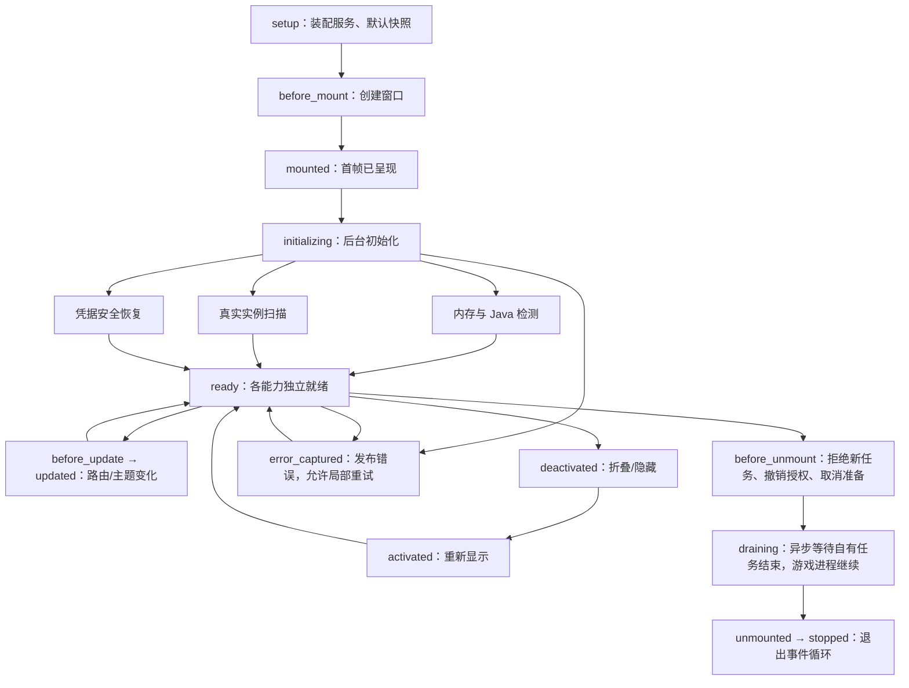
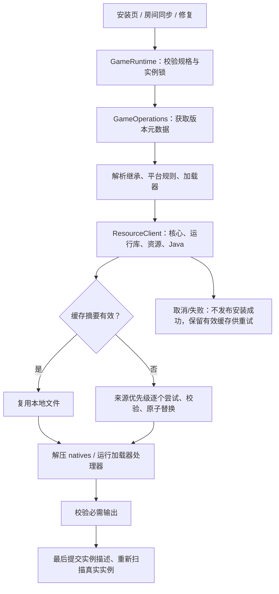
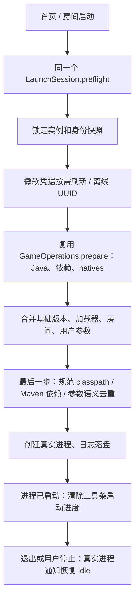

# 真实安装、启动与生命周期

本轮实施契约（2026-11-08）。正常入口只消费真实数据；接口替换原有占位流程，首页与未来房间不得各自实现安装或启动。

本轮修正（2026-11-09）：手动指定 Java 不兼容时，GameOperations.ensure_java 继续既有自动匹配/运行库下载，用户无需先返回设置。游戏显示模式在同一 SelectField 单选；build_launch_command 按 fullscreen 决定 --fullscreen 或 --width/--height，官方 has_custom_resolution 特性规则同步使用该判断。具体旧版设置取舍见第 24 份文档。

## 所有权与复用

| 所有者 | 输入 / 输出 | 线程、失败与取消 |
| --- | --- | --- |
| HttpClient | GET/POST、请求头、可选落盘与摘要 → 请求 ID、响应码、结果 | 所在线程的异步 Qt Network；TLS 不忽略，取消撤销通知；文件传输只在工作线程使用 |
| ResourceClient | 官方资源描述、来源排序、取消标记 → 校验后的本地文件 | 工作线程，有界并发、逐源回退、原子提交；命中有效缓存复用，不重复下载 |
| minecraft_metadata 领域函数 | 版本继承、规则、库、参数贡献 → 归一化元数据、最终命令 | 纯值/工作线程；循环继承、越界路径失败；最终语义去重保留参数和值的关系 |
| GameOperations | 安装规格 / 已有实例 → 实例、文件准备、Java、启动命令 | 同一工作流水线供安装、修复和启动复用；取消只保留可校验缓存，不提交半成品实例 |
| GameRuntime | 安装 / 修复 / 启动意图、稳定实例 ID → 真实任务和进程快照 | GUI 线程只调度工作、发布快照；不扫描/解压/等待进程。未来房间直接调用相同入口 |
| MicrosoftAccount | 设备码授权、刷新、登出 → Minecraft 姓名/UUID；令牌仅 C++ | 网络异步；轮询遵守 interval/slow_down；代数阻止迟到授权。刷新凭据用系统保护，不明文保存 |
| ApplicationLifecycle | 应用/窗口/页面事件 → 生命周期钩子及初始化状态 | 首帧后并行恢复身份、扫描实例、检测 Java/内存；折叠/切页不取消任务，退出异步收尾 |

`IdentitySession` 仍是身份呈现所有者，`LaunchSession.preflight` 仍是身份确认入口。二者注入服务，不在 QML 实现授权/进程状态机。目录列表沿用 InstallCatalogSession 和 GameCatalogService；安装执行读取所选版本，不另造目录服务。

## 应用与视图生命周期

钩子由 C++ 生命周期对象发出，不由页面 Timer 假装初始化完成。mounted 每进程一次；activated/deactivated 可反复；before_update/updated 带旧/新路由；error_captured 不终止其他初始化；before_unmount 幂等。页面卸载只释放呈现，业务任务归应用。启动时重新检测物理/可用内存并计算自动值，只保存 auto/manual 策略，不保存 auto 的计算结果；启动游戏前再取一次可用内存，避免后台程序变化后过量分配。

## 安装与房间同步共享流水线

Forge/NeoForge 处理器必须使用已匹配的 Java 绝对路径；禁止回退到字符串 java。各加载器适配元数据，文件下载与校验始终走同一资源服务。未知/不支持的格式明确失败，不把没有生成目标 JAR 的实例标为完成。

处理器可能分别需要同一 Maven 库的不同版本，下载阶段必须全部准备，不能提前删掉旧版本依赖。游戏 classpath 才应用继承覆盖和最终去重。已安装实例若缺少只能由处理器生成、不能直接下载的 JAR，会明确要求重新安装对应加载器，不冒充修复成功。

同一任务中，DNS、连接、TLS 或传输超时会将对应 origin 冷却 60 秒，后续文件先用下一候选，避免几千个文件逐一等待相同故障；冷却结束重新尝试优先源，没有其他候选时仍尝试。HTTP 404、摘要错误、磁盘错误及主动取消不触发源级冷却。传输故障信号归 HttpClient，策略只在 ResourceClient，不在各加载器复制。

## 启动与最终去重

不能对整个 QStringList 简单 removeDuplicates：参数值可以相同，`--add-opens` 等允许多项。库按 Maven group/artifact/classifier 和实际路径归一化，继承子版本覆盖父版本；单值 JVM/游戏参数最后贡献生效，重复的同一 add-opens 项去重、不同项保留。所有贡献完成后才执行最终命令归一化。

NeoForge 的 bootstrap 忽略列表必须使用实际原版核心 JAR 文件名，而非自定义实例名；其他 version_name 参数保留实例标识。Windows 日志配置传 file URL，避免盘符被误解为 URL 协议。真实进程日志合并 stdout/stderr，Windows 进程退出先禁用 notifier 再关闭句柄，避免退出回调继续使用无效句柄。

## 工具条进度

同一个菜单组件接收 activity 快照（active/progress/label）。启动准备优先于下载任务；进程启动后若仍有下载则继续显示下载，否则关闭效果。进度属于真实任务，不用视觉动画驱动业务。水面/波纹只是 DesignSystem 通用进度表面的绘制；隐藏时停止动画。面板主题隐藏广场，导航使用稳定工具 ID，不能改变联机/好友索引。

## 验证边界

必须验证：无身份不能启动；安装取消不提交实例；来源回退与缓存校验；无系统 PATH 时使用已下载 Java；继承与重复参数；每次初始化重新计算内存；取消后的迟到授权；管理页无启动按钮；空实例可安装；两个主题共享同一菜单进度。微软账号本人在浏览器完成授权，自动化不得伪造真人授权成功。

## 本次实际验收（Windows，2026-11-08）

原生 MSVC/Qt 6.8.1 构建成功；CTest 的 sessions、catalogs、runtime、qml_component_boundaries 四组全部通过，qmllint 无警告。界面回归首次 32 项中 31 项通过；剩余项为 QML 数组读取的测试断言类型，修正后与工具条水纹用例一起复跑通过。两种主题原生截图为 build/runtime-home.png、build/runtime-panel.png，均未输出 QML 运行错误。

原生关闭回归在隔离目录分别打开常规/面板主题，发 WM_CLOSE，并断言进程正常退出，覆盖最终关闭事件必须放行的行为。HttpClient 取消/超时后不再读取已关闭的 reply，避免产生多余的 QIODevice 警告。

Minecraft 1.20.1 另行验证缺少兼容 Java 17 的情况：自动下载 Mojang Java 17 并生成命令，使用 .buggcraft/runtime/java-runtime-gamma/windows-x64/bin/java.exe 的绝对路径，日志 build/live-java17-install-final.txt。随后临时移走该隔离验收目录的 java.exe，重试在约 34 秒内自动补回，通过摘要检查并再次生成正确命令，日志 build/live-java17-repair.txt；验收备份已清理。此机仍有系统 Java 21，该场景验证的是缺少兼容主版本，不能表述为整台机器未装 Java。

该联网验收发现 BUGG 源 TLS 握手停滞会拖慢逐文件回退，现已修复为上述任务级冷却。资源回归覆盖连续 JSON 与并发文件批次跳过故障 origin，同时证明 404 不影响其他文件；HTTP 回归覆盖超时通知及主动取消不误报故障。修复后原生编译和四组 CTest 全部通过。

以下均为真实下载安装、执行加载器处理器、启动离线验收角色、完成游戏渲染资源初始化，再停止本次自有游戏 PID；不是模拟运行状态。

| Minecraft | 加载器 | 结果与日志 |
| --- | --- | --- |
| 1.21.1 | 原版 | 通过，build/launch-1.21.1-vanilla.txt |
| 1.21.1 | Fabric 0.20.1 | 通过，build/launch-1.21.1-fabric-0.20.1.txt |
| 1.21.1 | Quilt 0.30.2 | 通过，build/launch-1.21.1-quilt-0.30.2.txt |
| 1.21.1 | Forge 52.1.21 | 通过，build/launch-1.21.1-forge-52.1.21.txt |
| 1.21.1 | NeoForge 21.1.265 | 通过，build/launch-1.21.1-neoforge-21.1.265.txt |

微软真实设备码接口已联网取得有效授权码；完整 OAuth/Xbox/XSTS/profile、刷新、取消迟到响应与凭据保护有可复现协议测试。尚未使用真人微软账号完成网页授权，不能把该步骤报告为已实测通过。macOS/Linux 分支尚未在对应系统运行验收。

房间服务还未接入；它后续消费现有端口与安装/准备流水线，不表示房间同步已经可用。任务历史当前仅在本次进程保留；跨进程重装会复用摘要有效文件，但尚未提供 Range 断点续传或任务日志恢复。

协议和底层实现参考：[微软设备码授权](https://learn.microsoft.com/en-us/entra/identity-platform/v2-oauth2-device-code)、[Qt QProcess](https://doc.qt.io/qt-6.8/qprocess.html)、[miniz 3.1.0](https://github.com/richgel999/miniz/releases/tag/3.1.0)。

联网安装验收使用显式开关 BUGG_TEST_LIVE_INSTALL=1、BUGG_TEST_LIVE_ROOT=隔离目录、BUGG_TEST_MC=游戏版本、BUGG_TEST_LOADER=加载器、BUGG_TEST_LOADER_VERSION=加载器版本，运行 runtime_test.exe live_install_and_prepare。真实进入游戏使用 BUGG_TEST_LIVE_LAUNCH=1、BUGG_TEST_INSTANCE=完整实例 ID，运行 live_launch_uses_same_runtime_and_clears_activity。普通 CTest 不依赖公网。首次运行时资源/Java 下载可能超过默认五分钟，单独联网验收需设置 QTEST_FUNCTION_TIMEOUT=1200000；取消和 HTTP 超时仍按生产规则执行，不因测试时限放宽而关闭。
